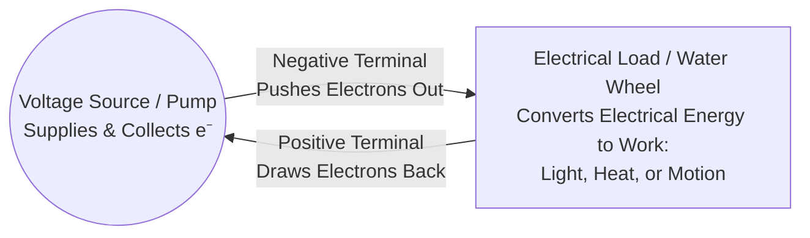

# ⚡ Electric Current, Charge Flow & Engineering Notation


> [!info] Lecture Source & Scope
> * **Course:** Basic Electronics Part 1 (ELC 110 — Section 1: [[DC Circuits]])
> * **Timestamp Covered:** `01:07:00` to `01:57:00`
> * **Core Focus:** Laws of electrostatic charges, the [[Coulomb]] ($Q$), the [[Ampere]] ($I$), $I = Q/t$ algebraic derivations, Electron Flow vs. [[Hole Flow]], signal propagation speed, [[Voltage Sources]], and [[Engineering Notation]].


---

## 🧲 1. The Two Laws of Electrostatic Charges (`01:11:13` – `01:17:33`)

> [!important] Immutable Laws of Physics
> Unlike civil laws, electrostatic laws govern every subatomic interaction inside your PCB traces, capacitors, and semiconductors [01:11:23, 01:11:48].

1. **First Law of Electrostatics:** **Like charges repel each other** 
   * Negative ($-$) repels Negative ($-$)
   * Positive ($+$) repels Positive ($+$)
1. **Second Law of Electrostatics:** **Opposite (unlike) charges attract each other** 
   * Negative ($-$) strongly attracts Positive ($+$) 

```
   [ - ] <─── Repulsion ───> [ - ]         (Like Charges Repel)
   [ + ] <─── Repulsion ───> [ + ]         (Like Charges Repel)
   [ - ] ─── Attraction ───> [ + ]         (Opposites Attract)
```

* **Why Current Moves:** Because knocked-free negative electrons and positive ions naturally attract one another to restore balance, providing a conductive path between them forces electrons to rush from the negative terminal toward the positive terminal 

---

## 📦 2. The Coulomb ($Q$) & The Ampere ($I$) 

### A. The Coulomb ($C$ or $Q$) — *The Batch Count of Electrons*
Just as we buy eggs by the dozen or fuel by the gallon, individual electrons are far too small to count one by one  We measure bulk electric charge ($Q$) in **Coulombs ($C$)**, named after Charles-Augustin de Coulomb

$$1\text{ Coulomb (C)} = 6.24 \times 10^{18}\text{ electrons}$$

* **Written out in standard form:** `6,240,000,000,000,000,000` electrons ($6.24$ followed by $16$ zeros, or moving the decimal point $18$ places to the right) 
* Because standard calculator displays overflow at $10$–$12$ digits, exponential/engineering notation is mandatory

### B. The Ampere ($A$ or $I$) — *The Flow Rate*
Named after André-Marie Ampère, the **Ampere (Amp)** is the universal SI unit for electric current ($I$) 
* **Definition:** $1\text{ Ampere}$ is defined as exactly **$1\text{ Coulomb}$ of charge ($6.24 \times 10^{18}$ electrons) moving past a single point in $1\text{ second}$** 
### C. Your First Core Formula: Current, Charge & Time
$$\mathbf{I = \frac{Q}{t}}$$

| Symbol  | Quantity         | Unit of Measure                                     |
| :------ | :--------------- | :-------------------------------------------------- |
| **$I$** | Electric Current | Amperes (Amps)                                      |
| **$Q$** | Electric Charge  | Coulombs *(must convert raw electrons to C first!)* |
| **$t$** | Time             | Seconds                                             |


1. **Find Current ($I$):** Cover $I \implies I = \frac{Q}{t}$ *(e.g., $2\text{ C}$ in $1\text{ s} = 2\text{ A}$; $0.5\text{ C}$ in $1\text{ s} = 0.5\text{ A}$)* [01:21:31, 01:25:33].
2. **Find Time ($t$):** Cover $t \implies t = \frac{Q}{I}$ 
3. **Find Charge ($Q$):** Cover $Q \implies Q = I \times t$ [01:26:35].

> [!warning] Hardware Rating & Fire Hazard Intuition
> * **The Fire Hose Analogy:** A residential service panel typically supplies $200\text{ A}$, which branches into $15\text{ A}$ or $20\text{ A}$ wall outlets . A $15\text{ A}$ circuit handles $15\text{ Coulombs/sec}$ ($15 \times 6.24 \times 10^{18} = 9.36 \times 10^{19}\text{ electrons/sec}$) 
> * Connecting a high-pressure fire engine pump to a thin garden hose causes the hose to burst . Similarly, forcing more Coulombs per second through a wire or PCB trace than its physical cross-section is rated for causes extreme heating and electrical fires
> 


## 🕳️ 3. Electron Flow vs. Hole Flow 

When an electron is knocked loose from a neutral atom and jumps to the next atom toward the positive terminal, it leaves behind a vacancy called a **[[Hole]]** (the absence of an electron)
```
  (-) Negative Terminal                                  (+) Positive Terminal
   ┌───────────────────────────────────────────────────────────────────────┐
   │   e⁻ ───►   e⁻ ───►   e⁻ ───►   e⁻ ───►   e⁻ ───►   e⁻ ───►           │
   │  (Atom)    (Atom)    (Atom)    (Atom)    (Atom)    (Atom)             │
   │         ◄─── ○    ◄─── ○    ◄─── ○    ◄─── ○    ◄─── ○                │
   └───────────────────────────────────────────────────────────────────────┘
      Electron Flow: Left to Right (- to +)
      Hole Flow:     Right to Left (+ to -)
```

| Flow Convention                       | Direction                                           | Who Uses It & Why                                                                                                                                                              |
| :------------------------------------ | :-------------------------------------------------- | :----------------------------------------------------------------------------------------------------------------------------------------------------------------------------- |
| **Electron Flow**                     | **Negative ($-$) $\longrightarrow$ Positive ($+$)** | Used in vocational tech, military training, and physical descriptions of metal conductors ($6.24 \times 10^{18}\text{ electrons/s} = 1\text{ A}$)                              |
| **[[Hole Flow]] / Conventional Flow** | **Positive ($+$) $\longrightarrow$ Negative ($-$)** | Used by electrical engineers, physicists, schematic symbols (arrows on diodes/transistors), and **semiconductor physics** ($6.24 \times 10^{18}\text{ holes/s} = 1\text{ A}$)  |

> [!tip] Key Takeaway
> Whether you track $6.24 \times 10^{18}$ electrons moving left-to-right or $6.24 \times 10^{18}$ holes moving right-to-left, **the magnitude of the current ($1\text{ A}$) is identical** [01:30:28]. Hole flow becomes essential when analyzing P-N junctions, diodes, and transistors 


---

## 🚀 4. How Current Travels Through a Conductor

* **The billiard-ball / table-push intuition:** While textbooks sometimes call current "electron drift," the *effect* of current across a circuit is not a slow, lazy float—it is felt almost **instantaneously** from one end of the wire to the other, like pushing one end of a rigid table and someone feeling the push immediately at the other end 
* **Speed of Electromagnetic Propagation (Speed of Light $c$):**
  1. **Metric (SI):** **$300,000,000\text{ m/s}$** ($3 \times 10^8\text{ m/s}$)
  2. **Statute Miles:** **$186,000\text{ miles/second}$** 
  3. **Nautical Miles (Radar / Aviation / Maritime):** **$161,000\text{ nautical miles/second}$** 

---

## 🔋 5. The Voltage Source & Fluid Pump Analogy 

To sustain continuous current flow, a circuit requires a valid **[[Voltage Source]]** (such as a battery or DC power supply) and an **[[Electrical Load]]


* **The Pump Analogy:** A water pump sucks water in from one side and pushes it out the other. Similarly, a battery supplies electrons from its **negative terminal** and collects them back at its **positive terminal**.
* **The Load (Water Wheel):** The load is the component that converts electrical energy into another useful form of energy—such as **light** (LED/bulb), **heat** (resistor/heater), or **mechanical motion** (DC motor/actuator)

---

## 🔢 6. Scientific vs. Engineering Notation 

* **Scientific Notation:** Uses any integer power of ten ($10^1, 10^2, 10^4, 10^5$, etc.) 
* **[[Engineering Notation]]:** Strictly groups exponents of $10$ into **multiples of three** ($10^3, 10^6, 10^9, 10^{12}$ and $10^{-3}, 10^{-6}, 10^{-9}, 10^{-12}$) so every number maps directly to a standard metric prefix 

### The Complete Engineering Notation Scale

| Multiplier (Power of $10$) | Prefix Name | Symbol | Decimal Equivalent | Common Hardware Examples |
| :--- | :--- | :---: | :--- | :--- |
| **$10^{12}$** | **Tera** | $\text{T}$ | $1,000,000,000,000$ | Terabyte ($\text{TB}$) storage drives [01:47:16, 01:48:20] |
| **$10^{9}$** | **Giga** | $\text{G}$ | $1,000,000,000$ | Gigahertz ($\text{GHz}$) RF/Wi-Fi, $\text{GB}$ RAM [01:46:04, 01:46:44] |
| **$10^{6}$** | **Mega** | $\text{M}$ | $1,000,000$ | Megaohm ($\text{M}\Omega$) resistors, $\text{MHz}$ clocks [01:45:39] |
| **$10^{3}$** | **kilo** | $\text{k}$ | $1,000$ | Kilohm ($\text{k}\Omega$) pull-up resistors, $\text{kV}$ [01:43:52, 01:44:42] |
| **$10^{0}$** | *(Base Unit)* | — | $1$ ($1$ to $999$) | Volts ($\text{V}$), Amps ($\text{A}$), Ohms ($\Omega$) [01:42:50, 01:43:36] |
| **$10^{-3}$** | **milli** | $\text{m}$ | $0.001$ | Milliamps ($\text{mA}$) in LEDs & sensors *(lethal!)* [01:49:29, 01:56:19] |
| **$10^{-6}$** | **micro** | $\mu$ *(mu)* | $0.000001$ | Microamps ($\mu\text{A}$), Microfarad ($\mu\text{F}$) caps [01:50:15, 01:56:36] |
| **$10^{-9}$** | **nano** | $\text{n}$ | $0.000000001$ | Nanofarad ($\text{nF}$) caps, nanometer ($\text{nm}$) silicon [01:51:21, 01:51:38] |
| **$10^{-12}$** | **pico** | $\text{p}$ | $0.000000000001$ | Picofarad ($\text{pF}$) crystal load capacitors [01:51:50] |

> [!danger] Calculator Entry Rule & Safety Warning
> 1. **Use the `EE` or `EXP` Key:** When entering $3 \times 10^3$ into a scientific calculator, type `3` `[EE]` `3`. **Never** type `3` `×` `10` `^` `3`, as doing so without parentheses causes order-of-operations errors (putting your answer a decimal place off during division) 
> 2. **Milliamps Can Kill:** In electronics and robotics logic circuits, you primarily work with **milliamps ($\text{mA}$, $10^{-3}\text{ A}$)** and **microamps ($\mu\text{A}$, $10^{-6}\text{ A}$)** rather than tens of Amps . Never underestimate milliamps—as little as $10\text{–}100\text{ mA}$ across the heart is fatal 

